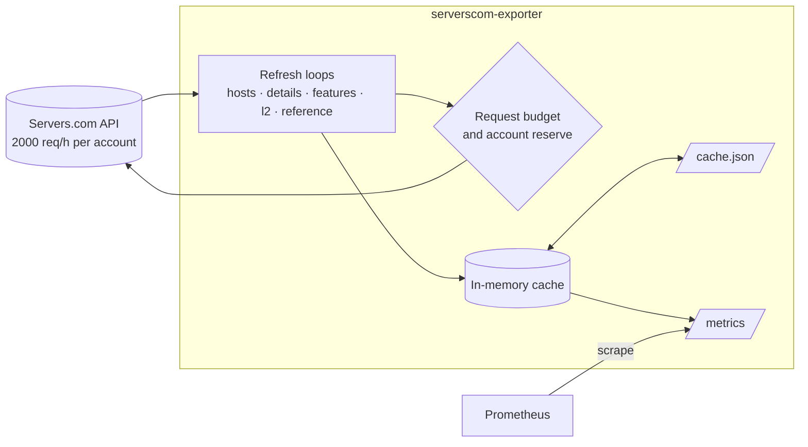

# serverscom-exporter

Prometheus monitoring for [Servers.com](https://www.servers.com/) Enterprise Bare
Metal: an exporter for the [Servers.com Public API](https://developers.servers.com/api-documentation/v1/),
a Helm chart with alert rules, and a Grafana dashboard.

The exporter turns the inventory and state of your dedicated servers into
metrics: power and operational status, labels, drives, switch ports, networks,
power feeds, server features (port aggregation, OOB public access), uplinks,
L2 segments, locations and racks. It is built around the API rate limit:
scrapes never call the API, and the exporter keeps its own request budget so
that Terraform, the CLI and other users of the account are not starved.

## Contents

- [Repository layout](#repository-layout)
- [How it works](#how-it-works)
- [Quick start](#quick-start)
- [Configuration](#configuration)
- [API rate limits and sizing](#api-rate-limits-and-sizing)
- [Cache persistence](#cache-persistence)
- [Metrics](#metrics)
- [Kubernetes](#kubernetes)
- [Grafana dashboard](#grafana-dashboard)
- [Alerts](#alerts)
- [Troubleshooting](#troubleshooting)
- [Development](#development)
- [CI and releases](#ci-and-releases)
- [Known gaps](#known-gaps)

## Repository layout

| Path | Contents |
|------|----------|
| [`src/`](src/README.md) | The exporter (Go), its Dockerfile and the full metric reference |
| [`charts/serverscom-exporter/`](charts/serverscom-exporter/README.md) | Helm chart: Deployment, cache PVC, ServiceMonitor, PrometheusRule, NetworkPolicy |
| [`grafana/`](grafana/README.md) | Grafana dashboard (v2 resource with tabs) |
| [`.github/workflows/`](.github/workflows) | CI and release workflows |

## How it works



- **Refresh loops** fetch data in the background, each at its own interval.
  A scrape of `/metrics` only renders the current cache and never calls the
  API, so scrape frequency does not affect API usage.
- **Request limits.** Every API request passes two checks: the exporter's own
  hourly budget (`--api.requests-per-hour`) and the account-wide limit
  reported in `X-RateLimit-*` headers, of which the exporter leaves a reserve
  (`--api.ratelimit-reserve`) to other users. Requests are not delayed while
  both have room. See [API rate limits and sizing](#api-rate-limits-and-sizing).
- **Cache file.** With `--cache.file` the cache is written to disk. After a
  restart the exporter serves full metrics immediately and only refetches
  what is due.
- **Single instance.** Run one exporter per account: every replica spends the
  same account limit.

| Loop | Data | Default interval | Cost per run |
|------|------|------------------|--------------|
| hosts | server list: statuses, power, labels, `updated_at` | `2m` | 1 request per 100 servers (page size) |
| details | drives, ports, networks, features, power feeds, configuration | `12h`, or as soon as a server's `updated_at` changes | 6 requests per server |
| features | server features only | `1h` (`0` disables) | 1 request per server |
| l2 | L2 segments, members, networks | `15m` | 1 page + 2 requests per segment |
| reference | locations, racks, uplink model catalogues | `24h` | a few requests |

The features loop exists because toggling a feature (e.g. port
disaggregation) does not change `updated_at`, so the details loop would not
notice it for up to 12 hours.

## Quick start

You need a Servers.com API token, created in the Servers.com customer portal.
The exporter only sends `GET` requests.

### Docker

```sh
docker run -d --name serverscom-exporter -p 9920:9920 \
  -e SERVERSCOM_API_TOKEN=... \
  -v serverscom-cache:/data \
  ghcr.io/rayderua/prometheus-serverscom-exporter:<version> \
  --cache.file=/data/cache.json

curl -s localhost:9920/metrics | grep serverscom_host_info | head
```

The image is based on `gcr.io/distroless/static-debian13:nonroot` (no shell,
uid 65532) and is published for linux/amd64 and linux/arm64. Image tags:
`X.Y.Z`, `X.Y` and `latest`.

### Kubernetes (Helm)

```sh
kubectl create namespace monitoring
kubectl -n monitoring create secret generic serverscom-api-token \
  --from-literal=token=$SERVERSCOM_API_TOKEN

helm install serverscom-exporter oci://ghcr.io/rayderua/charts/serverscom-exporter \
  --version <chart-version> -n monitoring \
  --set apiToken.existingSecret=serverscom-api-token \
  --set serviceMonitor.enabled=true \
  --set prometheusRule.enabled=true
```

The chart is also available from a classic Helm repository:

```sh
helm repo add serverscom https://rayderua.github.io/prometheus-serverscom-exporter
helm install serverscom-exporter serverscom/serverscom-exporter -n monitoring ...
```

See [Kubernetes](#kubernetes) and the [chart README](charts/serverscom-exporter/README.md).

### From source

```sh
cd src
go build ./cmd/serverscom-exporter
SERVERSCOM_API_TOKEN=... ./serverscom-exporter --cache.file=./cache.json
```

### Prometheus scrape config

Without the Prometheus Operator:

```yaml
scrape_configs:
  - job_name: serverscom
    scrape_interval: 1m   # metrics change with the refresh loops, not faster
    scrape_timeout: 30s
    static_configs:
      - targets: ["serverscom-exporter:9920"]
```

## Configuration

All settings are command-line flags; run `serverscom-exporter --help` for the
complete list.

### API token

Set exactly one of:

| Source | Example |
|--------|---------|
| File (recommended, e.g. a mounted Kubernetes Secret) | `--api.token-file=/etc/serverscom/token` or `SERVERSCOM_API_TOKEN_FILE` |
| Environment variable | `SERVERSCOM_API_TOKEN=...` |
| Flag (visible in the process list, avoid) | `--api.token=...` |

The exporter exits at startup if no token is set or both a token and a token
file are given.

### Flags

| Flag | Default | Description |
|------|---------|-------------|
| `--api.url` (`SERVERSCOM_API_URL`) | `https://api.servers.com/v1` | API base URL |
| `--api.timeout` | `30s` | Timeout of a single request |
| `--api.page-size` | `100` | `per_page` for collection endpoints |
| `--api.requests-per-hour` | `1000` | Exporter's own hourly request budget |
| `--api.ratelimit-reserve` | `300` | Pause when the account-wide remaining requests drop to this value |
| `--refresh.hosts-interval` | `2m` | Server list (power, statuses, labels) |
| `--refresh.details-interval` | `12h` | Maximum age of per-server details; changed servers are refreshed earlier |
| `--refresh.features-interval` | `1h` | Server features for all servers; `0` disables |
| `--refresh.l2-interval` | `15m` | L2 segments with members and networks |
| `--refresh.reference-interval` | `24h` | Locations, racks, uplink models |
| `--cache.file` | empty (off) | File to persist the cache to |
| `--cache.save-interval` | `1m` | How often to write the cache file if it changed |
| `--collector.host-labels` | `*` | Servers.com label keys exposed in `serverscom_host_labels`, comma-separated; `*` for all |
| `--web.listen-address` | `:9920` | Listen address; repeatable |
| `--web.telemetry-path` | `/metrics` | Metrics path |
| `--web.config.file` | empty | TLS and basic auth, see below |
| `--log.level` | `info` | `debug`, `info`, `warn`, `error` |
| `--log.format` | `logfmt` | `logfmt` or `json` |

### HTTP endpoints

| Path | Description |
|------|-------------|
| `/metrics` | Metrics (OpenMetrics supported) |
| `/-/healthy` | Returns `OK` while the process runs |
| `/` | Landing page with version and links |

### TLS and basic auth

`--web.config.file` takes an
[exporter-toolkit web config](https://github.com/prometheus/exporter-toolkit/blob/master/docs/web-configuration.md):

```yaml
tls_server_config:
  cert_file: /etc/serverscom-exporter/tls/tls.crt
  key_file: /etc/serverscom-exporter/tls/tls.key
basic_auth_users:
  prometheus: $2y$10$...   # bcrypt hash, e.g. htpasswd -nBC 10 "" | tr -d ':\n'
```

Basic auth covers every path, including `/-/healthy`.

### Host labels

Servers.com labels of a server become `label_<key>` labels of
`serverscom_host_labels`. Keys are sanitized to valid Prometheus label names.
Limit them to what you use to keep series small:

```sh
--collector.host-labels=env,team,role
```

## API rate limits and sizing

The Servers.com API allows **2000 requests per hour per account**, shared by
everything that uses the account. The exporter applies two limits:

1. **Its own budget**, `--api.requests-per-hour` (default 1000). The window
   opens with the first request and resets an hour later, like the API's.
   When it is used up, the exporter logs a warning, sets
   `serverscom_api_budget_exhausted` and waits for the reset.
2. **The account reserve.** When `X-RateLimit-Remaining` drops to
   `--api.ratelimit-reserve` (default 300), the exporter waits until the
   account window resets. A `429` response pauses it as well.

Interrupted loops resume where they stopped; cached data is kept meanwhile.

### Demand estimate

From the number of servers, segments and racks the exporter estimates how
many requests per hour the configured intervals need and how many a full
download costs (a start without a cache file). It exposes the estimate as
metrics and logs a recommendation whenever it changes:

```
level=WARN msg="API demand does not fit into the request budget; the exporter will wait for budget resets"
  requests_per_hour=538 full_refresh_requests=243 budget_per_hour=500 ... recommended="--api.requests-per-hour=700"
```

The recommended budget is the steady-state demand plus 25% headroom, at least
one full download, and at most the account limit minus the reserve. If even
that does not fit, the recommended intervals are raised proportionally.

### Example

100 servers, 10 L2 segments, default intervals:

| Loop | Requests per run | Requests per hour |
|------|------------------|-------------------|
| hosts | 1 | 30 |
| details | 600 | 50 |
| features | 100 | 100 |
| l2 | 21 | 84 |
| reference | ~5 | ~0 |
| **Total** | full download ≈ 630 | ≈ 265 |

Both fit into the default budget of 1000: a start without a cache downloads
everything within the first hour, then the exporter uses about a quarter of
its budget. With the default reserve of 300, the exporter's budget leaves at
least 700 requests per hour to other users of the account.

At about 160 servers a full download no longer fits into 1000 requests; the
exporter then recommends a larger `--api.requests-per-hour` (up to 1700, the
account limit minus the reserve) or longer intervals. With a persisted cache
a full download happens only once.

Ways to lower the demand, by impact:

- raise `--refresh.features-interval` or set it to `0` if you do not need
  feature changes faster than `--refresh.details-interval`;
- raise `--refresh.l2-interval` if you have many segments;
- raise `--refresh.details-interval`: changed servers are still refreshed
  right away;
- keep `--cache.file` so restarts do not download everything again.

Useful queries:

```promql
# requests the exporter needs per hour, by loop
serverscom_exporter_requests_per_hour_estimated

# configured vs recommended budget
serverscom_api_requests_budget_per_hour
serverscom_api_requests_per_hour_recommended

# actual request rate per hour, by endpoint and status
sum by (endpoint, code) (rate(serverscom_api_requests_total[15m])) * 3600

# account-wide requests left until the window resets
serverscom_api_ratelimit_remaining
```

## Cache persistence

With `--cache.file=/data/cache.json` the cache is saved every
`--cache.save-interval` (if it changed) and on shutdown, via a temporary file
and rename. On start it is loaded and each loop waits until its data is due.
A missing, unreadable or outdated-format file is ignored and the exporter
starts empty.

The file holds inventory data (hostnames, IPs, labels) but no token. In the
Docker image `/data` is writable by the `nonroot` user; the Helm chart puts it
on a PVC.

## Metrics

All server metrics carry `host_id`, `title`, `location` and `rack`, so
dashboards filter by location and rack without joins. The full list is in
[src/README.md](src/README.md#metrics). Groups:

| Group | Examples |
|-------|----------|
| Servers | `serverscom_host_info`, `_labels`, `_status`, `_operational_status`, `_power_status`, `_powered_on`, `_scheduled_release_timestamp_seconds` |
| Hardware | `serverscom_host_configuration_info`, `_ram_size`, `_drive_slot_info`, `_drive_capacity` |
| Network | `serverscom_host_connection_info`, `_connections`, `_network_info`, `_uplink_info`, `_uplink_redundant`, `_uplink_aggregated` |
| Features and power | `serverscom_host_feature_status`, `_feature_enabled`, `_power_feed_status`, `_power_feed_up` |
| L2 segments | `serverscom_l2_segment_info`, `_member_info`, `_network_info` |
| Reference | `serverscom_location_info`, `serverscom_rack_info` |
| Exporter | `serverscom_exporter_last_refresh_success_timestamp_seconds`, `_refresh_errors_total`, `_build_info`, demand estimate |
| API | `serverscom_api_requests_total`, `_request_duration_seconds`, `_ratelimit_*`, `_budget_*` |

Example queries:

```promql
# servers that are powered off
serverscom_host_powered_on == 0

# servers by location and power status
count by (location, status) (serverscom_host_power_status)

# redundant uplinks that are not aggregated on the switch side
serverscom_host_uplink_redundant == 1 unless on (host_id) serverscom_host_uplink_aggregated == 1

# servers with OOB public access enabled
serverscom_host_feature_enabled{feature="oob_public_access"} == 1

# servers scheduled for release within 7 days
serverscom_host_scheduled_release_timestamp_seconds - time() < 7 * 86400

# age of cached data, by resource
time() - serverscom_exporter_last_refresh_success_timestamp_seconds
```

## Kubernetes

The [Helm chart](charts/serverscom-exporter/README.md) runs the exporter the
way it is meant to run:

- one replica with the `Recreate` strategy, so two pods never share the
  account limit;
- the token mounted from a Secret as a file (`apiToken.existingSecret`, or
  `apiToken.value` to let the chart create it);
- the cache on a PVC (`persistence.*`, kept on `helm uninstall`);
- non-root, read-only root filesystem, no capabilities, no service account
  token;
- optional ServiceMonitor, PrometheusRule with alerts, NetworkPolicy, and
  TLS/basic auth via `webConfig`.

Exporter flags are set under `config` in the values, other flags in
`extraArgs`:

```yaml
apiToken:
  existingSecret: serverscom-api-token
config:
  requestsPerHour: 1200
  hostLabels: env,team,role
  refresh:
    featuresInterval: 2h
serviceMonitor:
  enabled: true
  labels:
    release: kube-prometheus-stack   # match your Prometheus serviceMonitorSelector
prometheusRule:
  enabled: true
  labels:
    release: kube-prometheus-stack
```

## Grafana dashboard

[`grafana/dashboards/serverscom.json`](grafana/dashboards/serverscom.json) has
tabs for Overview (including a rate limit forecast), Servers, Power & OOB,
Network, Drives and Exporter, with variables for data source, location, rack
and server.

It is a Grafana **dashboard v2** resource and needs Grafana 13 or newer. v2
dashboards cannot be provisioned from files or ConfigMaps (the Grafana
sidecar); import it in the UI, through the API or Git Sync. Details in
[grafana/README.md](grafana/README.md).

## Alerts

The Helm chart ships these rules (`prometheusRule.enabled=true`):

| Alert | Severity | Condition |
|-------|----------|-----------|
| `ServerscomExporterDown` | warning | target down for 5m |
| `ServerscomRefreshStale` | warning | server list older than 1h (`prometheusRule.staleThreshold`) |
| `ServerscomRefreshErrors` | warning | more than 3 failed refreshes of a resource in 30m |
| `ServerscomBudgetExhausted` | info | own hourly budget used up for 15m |
| `ServerscomRateLimitLow` | warning | account-wide remaining at or below the reserve for 5m |

Outside Kubernetes, copy the expressions from
[`templates/prometheusrule.yaml`](charts/serverscom-exporter/templates/prometheusrule.yaml)
and replace the `namespace`/`service` selectors with your `job`.

## Troubleshooting

Start with the logs; every refresh, pause and recommendation is logged.
`--log.level=debug` logs every API request with its status and the remaining
budget and account limit.

| Symptom | Cause and fix |
|---------|---------------|
| Exits with `Cannot read API token` | No token, an unreadable token file, or both a token and a token file are set. |
| `serverscom_api_requests_total{code="401"}` grows, refreshes fail | Invalid or revoked token. |
| `/metrics` has only exporter and API metrics right after start | The first refresh is still running. Without a cache file a full download can take one or more budget windows; watch `Host details processed` progress in the logs. |
| `Exporter request budget is used up, waiting for the hourly reset` | Demand exceeds `--api.requests-per-hour`. Follow the `recommended=` flags in the warning or see [sizing](#api-rate-limits-and-sizing). Can happen once on a start without a cache with many servers. |
| `Account rate limit reserve reached, pausing API requests` | Other API users (Terraform, CLI, another exporter) use most of the account limit. Check for a second exporter replica; lower the exporter's demand or the reserve. |
| `serverscom_api_requests_total{code="429"}` | The account limit was hit; the exporter pauses until the reset. |
| Drives or ports change late | Details are refreshed when `updated_at` changes or after `--refresh.details-interval`. If the API does not bump `updated_at` for such changes, lower the interval. |
| Port aggregation / OOB access changes late | Feature changes do not bump `updated_at`; they are picked up by the features loop (`--refresh.features-interval`). |
| `Cannot save cache` | The cache directory is not writable by uid 65532. Fix the volume permissions (the chart sets `fsGroup`). |
| Kubernetes probes fail with basic auth | Basic auth also covers `/-/healthy`; set `probes.type: tcpSocket` in the chart. |

## Development

Requirements: Go (version from [`src/go.mod`](src/go.mod), latest patch
release), Docker with buildx, Helm 3.8+ or 4, and for some checks
[golangci-lint](https://golangci-lint.run/), the
[helm-unittest](https://github.com/helm-unittest/helm-unittest) plugin and
`promtool` from Prometheus.

### Tests

| What | Command | Where |
|------|---------|-------|
| Go unit tests | `go test -race ./...` | `src/` |
| Go linters | `golangci-lint run ./...`, `go vet ./...` | `src/` |
| Known vulnerabilities | `go run golang.org/x/vuln/cmd/govulncheck@latest ./...` | `src/` |
| Image smoke test | `test/smoke.sh <image>` | `src/` |
| Binary smoke test | `EXPORTER_BIN=./serverscom-exporter test/smoke.sh` | `src/` |
| Chart lint | `helm lint --strict charts/serverscom-exporter --set apiToken.value=test` | repo root |
| Chart unit tests | `helm unittest charts/serverscom-exporter` | repo root |
| Alert rule tests | `promtool test rules grafana/alerts/tests/*.test.yml` | repo root |

The **smoke test** starts [`src/test/mockapi`](src/test/mockapi/main.go), a
fake Servers.com API with two servers and one L2 segment, runs the exporter
image (or a local binary) against it with `--api.page-size=1` to exercise
pagination, and checks `/-/healthy` and the main metrics. Then it stops the
API, restarts the exporter and checks that the same data is served from the
cache file. The mock is handy for local development as well:

```sh
cd src
go run ./test/mockapi --listen=:8080 --token=test &
go run ./cmd/serverscom-exporter --api.url=http://localhost:8080/v1 --api.token=test
```

Chart unit tests live in
[`charts/serverscom-exporter/tests/`](charts/serverscom-exporter/tests) and are
not packaged. With Helm 4, install the plugin with
`helm plugin install https://github.com/helm-unittest/helm-unittest --verify=false`.

### Build

```sh
docker build -t prometheus-serverscom-exporter \
  --build-arg VERSION=$(git describe --tags --match 'v*' --always) \
  --build-arg REVISION=$(git rev-parse HEAD) \
  src/
```

Code layout under `src/internal/`:

| Package | Responsibility |
|---------|----------------|
| `api` | HTTP client: pagination, request budget, account rate limit, client metrics |
| `cache` | Snapshot of all data, the store and the cache file |
| `refresher` | Refresh loops, change detection, demand estimate and recommendations |
| `collector` | Renders the snapshot as Prometheus metrics |

Branches: work happens on `development`; releases are made from `main`.

## CI and releases

GitHub Actions ([`.github/workflows`](.github/workflows)):

- **CI** (every push and pull request), jobs:
  - *Go tests*: `go test -race` with a per-package coverage table in the job
    summary and `coverage.out` as an artifact;
  - *Go lint*: `gofmt`, `go vet`, golangci-lint, govulncheck;
  - *Docker image*: linux/amd64 and linux/arm64 build without push, then the
    smoke test of the amd64 image against the mock API;
  - *Helm chart*: version bump check, `helm lint`, helm-unittest, kubeconform,
    `promtool check rules` on the rendered PrometheusRule;
  - *Alert rules*: `promtool check rules` and `promtool test rules` for
    [`grafana/alerts`](grafana/alerts).

  Go jobs use the latest Go 1.27 patch release, so govulncheck does not
  report standard library issues fixed since the version in `go.mod`.
- **Releases** are made from tags on commits of `main`; tags elsewhere fail.
  The exporter image and the chart are versioned independently.

| Tag | Releases | Version |
|-----|----------|---------|
| `vX.Y.Z`, `vX.Y.Z-rc.N` | image `ghcr.io/rayderua/prometheus-serverscom-exporter` (`X.Y.Z`, `X.Y`, `latest`; pre-releases only their own tag), linux/amd64 and linux/arm64 | from the tag |
| `chart-X.Y.Z` | chart `oci://ghcr.io/rayderua/charts/serverscom-exporter` and the Helm repository `https://rayderua.github.io/prometheus-serverscom-exporter` | `version` in `Chart.yaml`, must match the tag |

Each tag also creates a GitHub release; only image releases are marked
"Latest". An image is pushed only after it passes the smoke test. For the
Helm repository, the release workflow adds the chart to `index.yaml` on the
`gh-pages` branch; the entry points to the `.tgz` attached to the GitHub
release. GitHub Pages must be enabled for the `gh-pages` branch.

New exporter version:

```sh
git tag v1.4.0 && git push origin v1.4.0       # on main: releases the image
# PR to main: appVersion: "1.4.0" and a new version in Chart.yaml
git tag chart-0.3.1 && git push origin chart-0.3.1
```

Chart-only changes need just the `version` bump and a `chart-*` tag. The chart
release fails if the image of its `appVersion` is not published yet.

## Known gaps

Some API details are not yet verified against the live API (full list in
[src/README.md](src/README.md#to-verify-against-the-live-api)):

- the full set of feature `status` values (`feature_enabled` and
  `uplink_aggregated` assume `activated`);
- units of `ram_size` and drive `capacity` (most likely GB);
- whether `updated_at` changes when drives or ports change;
- the maximum `per_page` value.
